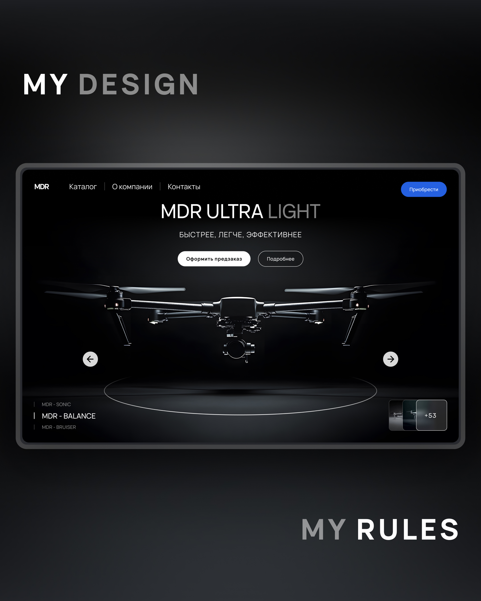
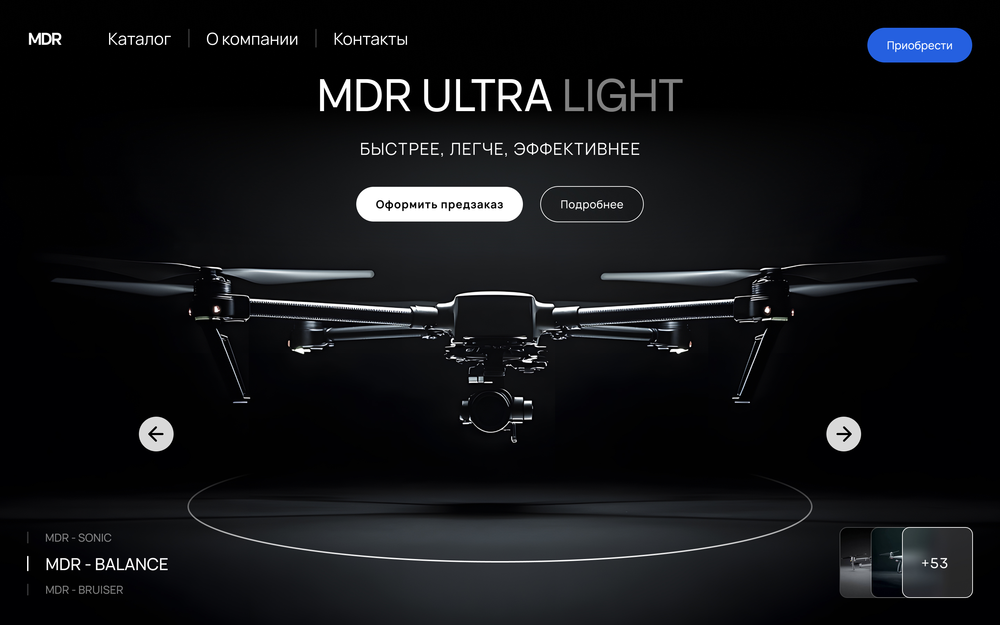

# MDR Ultra Light

Дизайн первого экрана сайта для дрона.

## О проекте

Макет создан [Mitfart](https://github.com/Mitfart) как самостоятельная абстрактная практика веб-дизайна. Это концепция, а не выполненный заказ или готовый работающий сайт. В будущем макет может быть реализован в HTML.

[Открыть макет в Figma](https://www.figma.com/design/ksBqvApM7vn3usovbo6q3e/YudaevSchool_1?node-id=0-1&t=ZuNvIeEe1YTVssXh-1)

## Файлы

- `images/` — превью и экспорт экрана.
- `assets/` — исходные изображения.
- `fonts/` — доступные файлы шрифтов, если они были в материалах проекта.

[English](README_EN.md)