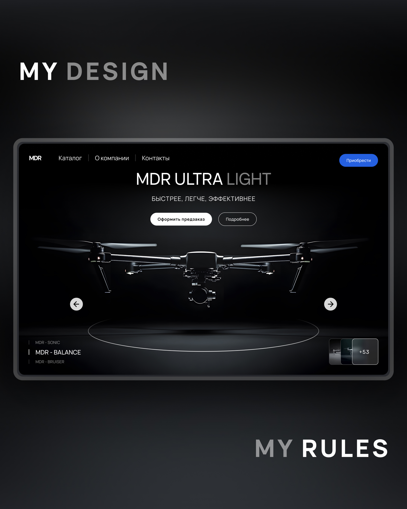
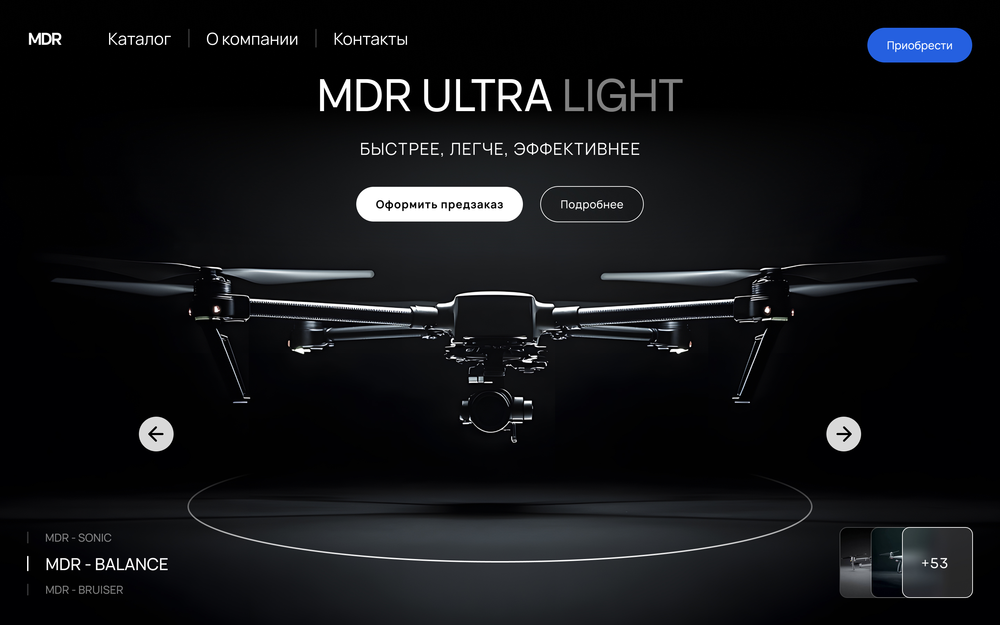

# MDR Ultra Light

A first-screen website design for a drone.

## About

Designed by [Mitfart](https://github.com/Mitfart) as an independent, abstract web design exercise. This is a concept, not client work or a finished live website. The design may be implemented in HTML in the future.

[Open the design in Figma](https://www.figma.com/design/ksBqvApM7vn3usovbo6q3e/YudaevSchool_1?node-id=0-1&t=ZuNvIeEe1YTVssXh-1)

## Files

- `images/` — previews and screen exports.
- `assets/` — source images.
- `fonts/` — available font files, where provided with the project materials.

[Русский](README.md)

## Original image filenames

- `assets/asset-1.png` — `Дрон.png`
- `assets/asset-2.jpg` — `Пример - дрон 1.jpg`
- `assets/asset-3.jpg` — `Пример - дрон 2.jpg`
- `assets/asset-4.jpg` — `Пример - дрон 3.jpg`
